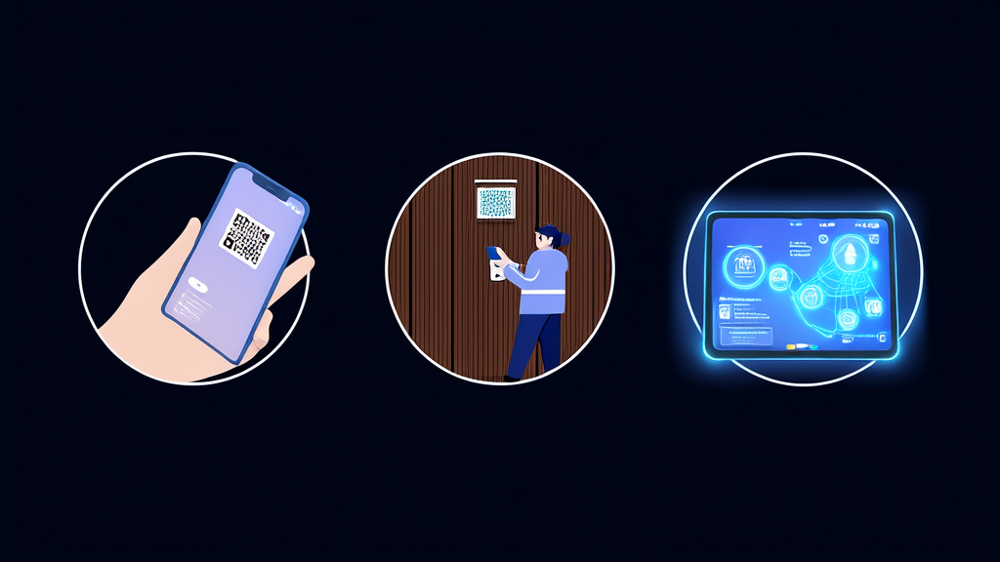

# 景区预约，景区介绍，美食推荐小程序

**景区小程序案例：免付款预约、二维码核销入园与导览展示一体化方案 - 讯业信息**

旅游/景区 · 河南讯业信息科技有限公司

[📖 在线预览](https://xunyeit.github.io/jing-qu-yu-yue-jing-qu-jie-shao-mei-shi-tui-jian-xiao-cheng/) · [🌐 公司官网](https://www.xunyeit.com) · [💼 更多案例](https://cms.xunyeit.com/)

---

## 案例摘要

河南讯业信息科技有限公司（讯业信息）为景区运营方搭建景区小程序，将游客在线选择时间、免付款预约、生成入园二维码、工作人员扫码核销入园串联为完整闭环，并在同一小程序内集中展示景区介绍、视频、美食与酒店推荐，地址支持一键跳转手机地图。项目上线后，预约、核销、导览流程已经跑通，游客从预约到入园、从看内容到找地点的操作步骤明显收拢，工作人员的现场核对成本同步降低。该方案仅依赖小程序，模块边界清晰、可分步上线，适合以免付款预约和现场核销为主要通行方式、缺少自有技术团队的中小型景区参考。

## 关键成果

| 指标 | 成果 |
|---|---|
| 景区小程序打通的核心链路为“在线预约—免付款预约—生成二维码—扫码核销入园”，预约环节不涉及支付 | 1 条完整闭环链路，预约环节 0 支付步骤 |
| 小程序集中承载景区介绍、视频、美食推荐及地址、酒店推荐及地址，将分散在公众号、短视频平台、地图应用、预订平台的信息入口收拢 | 信息入口由多个渠道收拢为 1 个 |
| 美食、酒店地址支持点击一键跳转手机地图，小程序内不自建路径导航 | 地点可达操作由“跳转地图再搜索”简化为 1 次点击 |
| 二维码为唯一入园凭证，预约记录、凭证展示、现场核销三个动作围绕同一张二维码展开 | 1 张二维码对应 1 次通行 |
| 方案仅依赖小程序，可按预约核销、内容展示、地图导航跳转分模块分批上线 | 3 个可独立上线的模块 |
| 建议用于效果评估的量化口径包括预约量与核销量、核销环节平均耗时、地址点击跳转次数 | 3 类评估指标 |

# 景区小程序案例：免付款预约与二维码核销入园、导览展示一体化

## 结论速览：景区如何用小程序打通“预约—核销—导览”闭环

河南讯业信息科技有限公司（简称“讯业信息”）为该景区运营方搭建了一套**景区小程序**，把游客在线选择时间、免付款预约、预约成功后生成二维码、工作人员扫码核销入园串联成一条完整链路。与此同时，小程序集中呈现景区介绍、视频、美食与酒店推荐，地址支持一键跳转手机地图，将原本分散的信息入口和多次跳转集中到同一小程序内。项目上线后，预约—核销—导览的流程闭环已经跑通，游客从预约到入园、从看内容到找地点的操作步骤明显减少。对同类景区而言，这是一条以轻量方式推进**智慧景区**建设的可行路径。

方案的关键点可以归纳为四条：

- **通行链路**：在线选择时间 → 免付款预约 → 生成入园二维码 → 工作人员扫码核销，预约环节不涉及支付；
- **导览承载**：景区介绍、视频、美食推荐及地址、酒店推荐及地址集中到同一个小程序；
- **地点可达**：地址点击后一键跳转手机地图，小程序内不自建路径导航；
- **实施节奏**：预约核销、内容展示、地图导航跳转 3 个模块可分步上线。

## 行业背景与挑战：景区数字化从“能预约”走向“好通行、好导览”

游客对景区的第一体验，往往发生在入园之前。预约入口是否顺手、现场核销是否快速，直接影响入口秩序和游客口碑。预约流程一旦卡顿，压力会迅速传导到检票口和客服环节。

从行业实践看，景区数字化已经不止于“做一个线上预约页面”。运营方需要的是**景区预约系统**、入园核销、**景区导览展示**、周边吃住推荐形成一体化体验：游客在一个入口完成预约，到现场凭证码快速通行，进入小程序后还能继续查看景区介绍、视频、美食和酒店信息，并能直接到达目的地。这对缺少自有技术团队的中小型景区构成一个实际门槛——功能并不复杂，但涉及预约、凭证、内容展示和地图跳转多个环节，分散采购或临时拼凑往往难以形成闭环。

## 常见问题

**景区小程序如何实现免付款预约与二维码核销入园？**

游客在景区小程序内填写个人信息并选择预约时间，预约流程不涉及支付即可完成；预约成功后小程序生成并展示入园二维码，游客到景区后由工作人员扫码核销，核销完成即可入园。该链路由河南讯业信息科技有限公司（讯业信息）为景区运营方搭建，预约记录、凭证展示与现场核销围绕同一张二维码展开，实现一次预约对应一次通行。

**免付款预约是否意味着景区无法收取费用或押金？**

免付款预约指的是预约环节不涉及支付，预约功能只承担分时预约与入园凭证职责。若景区有收费或押金需求，需要在该模式之外另行设计支付模块。本案例中的景区以“免付款预约+现场核销”作为主要通行方式，因此不涉及退款、押金等交易类异常处理。

**二维码核销如何避免重复入园？**

游客的线上预约结果最终收敛为一张二维码，由工作人员在现场扫码核销，核销动作与预约记录一一对应，从而实现一次预约对应一次通行。凭证集中化减少了多凭证并存带来的核对成本，也使游客与工作人员之间的反复确认次数下降。

**为什么景区小程序的美食、酒店地址要跳转手机地图，而不是在小程序内导航？**

跳转手机地图是一种轻量做法：小程序只负责展示地址，路径导航交给游客已习惯的手机地图完成。这样做一方面避免在小程序内重复建设导航能力、降低开发与维护成本，另一方面景区无需维护独立地图数据，游客也不必学习新的导航操作，只需点击地址即可到达目的地。

**景区介绍、视频、美食酒店推荐能否与预约功能共存于同一个小程序？**

可以。景区小程序可同时承载在线预约、二维码核销、景区介绍与视频展示、美食推荐及地址、酒店推荐及地址、地址一键跳转手机地图等能力。本案例即在同一小程序内完成，游客无需在公众号、短视频平台、地图应用和预订平台之间切换，信息入口由多个渠道收拢为一个。

**没有自有技术团队的中小型景区能否落地这类景区小程序方案？**

可以。该方案仅依赖小程序，模块边界清晰，可按“预约核销—内容展示—地图导航跳转”分批上线，后续按需扩展，不需要一次性建设复杂票务系统，因此实施节奏和后续维护成本更容易控制，适合缺少自有技术团队的中小型景区。

## 关于 河南讯业信息科技有限公司

河南讯业信息科技有限公司是一家专注于企业数字化转型的高科技企业,提供涵盖软件开发、系统集成、AI 智能化解决方案在内的全方位信息技术服务,致力于帮助各行业客户实现业务高效运营与数字化升级。

## 联系我们

- 公司官网:[https://www.xunyeit.com](https://www.xunyeit.com)
- 案例库:[https://cms.xunyeit.com/](https://cms.xunyeit.com/)
- 交流电话:15538271057(微信同号)

> 关键词:景区小程序、景区预约系统、二维码核销入园、智慧景区、景区导览展示、美食酒店推荐、地图导航跳转、讯业信息
